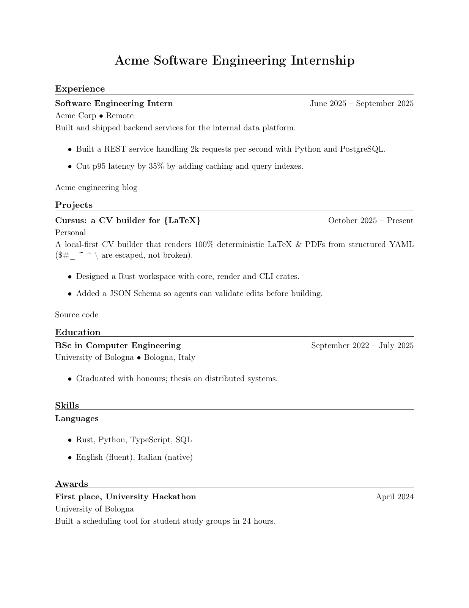

# Cursus

[](https://github.com/tredicim/cursus/actions/workflows/ci.yml)

> Write your career once. Tailor it for every job.

A modular, local-first CV builder that renders to LaTeX. You keep all your
experiences, projects, skills and education in one place, then pick exactly what
goes into each CV, and which *framing* of it, for every application.

**Status:** early, but the first pipeline works. Entries and targets are YAML,
`cursus validate` checks them, and `cursus build` renders the `classic` template
to LaTeX and PDF. `init`, `list`, the desktop app and the ATS checker are next.
See [PLAN.md](PLAN.md).

## The problem

Every application needs a slightly different CV. Today that usually means
copying old LaTeX files, pasting a job posting into a chatbot, and hoping the
result is consistent. It works, but it is manual, error-prone, and nothing is
reusable.

## The idea

- **One source of truth.** Experiences, projects, skills and education live in
  structured data files, not inside a `.tex` file.
- **Variants.** The same experience can be written several ways, e.g. a
  *data scientist* framing and a *software engineer* framing.
- **Targets.** A target describes one CV: which entries to include, which
  variant of each, in what order, with which template.
- **A desktop app.** Edit entries, build targets and preview the PDF in a
  downloadable app, working on the same files the CLI uses.
- **LaTeX out.** A target is rendered through a template into a LaTeX document
  and compiled to PDF.
- **Agent-friendly.** A small CLI with machine-readable output and a published
  schema, so tools like Claude Code or opencode can tailor a CV to a job posting
  by editing data and running commands, instead of rewriting LaTeX by hand.

## Planned features

- [x] Data model and validation
- [x] Targets (selection of entries and variants)
- [x] LaTeX templates and PDF build (`classic`)
- [ ] Desktop app (library, target builder, live PDF preview)
- [ ] Agent integration (schema, `AGENTS.md`, JSON output)
- [ ] ATS-style checker (text extraction, structure, keyword coverage)



## Tech

A Rust core shared by a desktop app (Tauri, TypeScript UI) and a CLI for scripting and agents. Details and open questions in [PLAN.md](PLAN.md).

## CLI

`validate`, `build` and `schema` work. `init` and `list` still return
`not_implemented`.

```sh
cargo run -p cursus-cli -- --help

cd examples/valid
cargo run -p cursus-cli -- validate
cargo run -p cursus-cli -- build acme-swe
```

`build` writes `output/<target>.tex` and `output/<target>.pdf`; use
`--output <directory>` or `--output <file>.pdf` to choose another location.
It needs Tectonic, `latexmk` or `pdflatex` on `PATH`; see
[docs/building.md](docs/building.md).

Every command accepts `--json`; machine-readable output goes to stdout as one
object:

```json
{"ok":true,"command":"validate","data":{"entries":5,"targets":1}}
```

```json
{"ok":false,"command":"build","error":{"code":"target_not_found","message":"target `nope` not found in targets/"}}
```

Exit codes: `0` success, `1` invalid data or unknown target, `2` usage error,
`3` I/O error, `4` build failed, `5` not implemented.

## Data and templates

- [Data model](docs/data-model.md): YAML layout, fields, validation rules and
  the JSON Schema.
- [Building](docs/building.md): compiler choice, output paths, failures and
  determinism.
- [Templates](docs/templates.md): `classic` structure, escaping and how to add
  a theme.
- [`schema.json`](schema.json): generated schema for editors and agents.
- [`examples/`](examples/): a complete project and one fixture per broken rule.

## Contributing

See [CONTRIBUTING.md](CONTRIBUTING.md) for setup, the check commands, commit
conventions and the pull request flow.

## License

Licensed under either of

- [Apache License, Version 2.0](LICENSE-APACHE)
- [MIT license](LICENSE-MIT)

at your option. You can pick either one.
